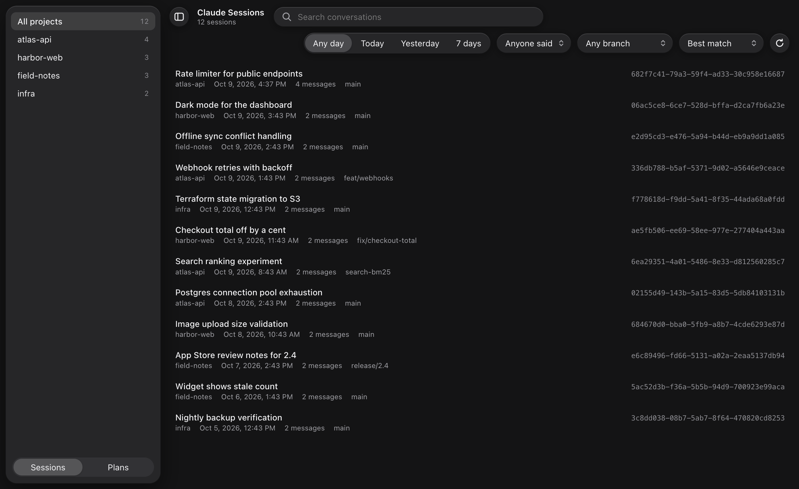
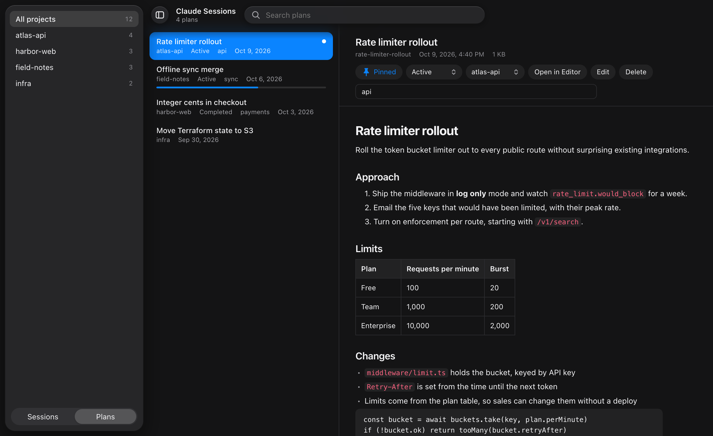

# Claude Sessions

Search every Claude Code conversation you've had, and read and organize the plans Claude writes.

It comes in two forms that share the same data:

- **A web version** that runs anywhere Python does, including macOS and Linux. It uses only Python's standard library.
- **A native macOS app** built with AppKit.



## What it does

**Search your sessions**

- Search every session in `~/.claude/projects`. Only what you and Claude actually wrote is searched, not tool output or injected context.
- Every word must match. Put `"quotes"` around a phrase, and end a word with `*` to match its prefix.
- Filter by project, git branch, who said it (you or Claude), and when the session was active: today, yesterday, or the last 7 days.
- Sort by best match, most recent, most mentions, or longest.
- Copy a session ID, or a ready-to-paste `cd <project> && claude --resume <id>` command.
- Open the transcript file in Finder or your file manager.

**Read and organize plans**

- Read every plan in `~/.claude/plans` as formatted text, with headings, lists, tables and code.
- Pin a plan, set its status, assign it to a project, tag it, edit it, or delete it.
- It remembers how far you've read each plan.
- It works out which project a plan belongs to by finding the session that wrote it.

**Keep the project list tidy**

- Sessions in Claude Code worktrees (`<repo>/.claude/worktrees/<name>`) are grouped under their repo.
- Archive a project you're done with. It leaves the sidebar and the "All projects" list until you unarchive it from the **Archived** section at the bottom of the sidebar.



## Web version (macOS and Linux)

You need Python 3.9 or later with SQLite's FTS5 full-text search. The Python from python.org, Homebrew, `uv` and most Linux distributions includes FTS5. There are no packages to install.

Run it from a checkout:

```sh
cd web
python3 -m claude_sessions
```

Or install it as a `claude-sessions` command:

```sh
pipx install ./web
claude-sessions
```

It indexes your transcripts, then opens <http://localhost:8787> in your browser. Later runs only re-read transcripts that changed. Add `--reindex` to rebuild the search index from scratch.

**Shortcuts** (on Linux, use Ctrl in place of ⌘):

| Action | Shortcut |
|---|---|
| Search | ⌘F |
| Copy the selected session's ID | ⌘C, Enter, or double-click |
| More actions | Right-click a session or project, or press Shift+F10 |
| Move through a list | Up and Down arrows |
| Save a plan while editing | ⌘S |
| Delete the selected plan | Delete |

## macOS app

You need macOS 26 or later on Apple silicon, and the Xcode command line tools (`xcode-select --install`).

```sh
./build-app.sh
```

This builds `Claude Sessions.app` and installs it in `/Applications`.

## Where your data lives

| Path | What's in it |
|---|---|
| `~/.claude/projects/**/*.jsonl` | Claude Code transcripts. These are only ever read. |
| `~/.claude/plans/*.md` | Plans |
| `~/.claude/plans/.plan-manager.json` | Pins, status, tags, reading position, plan projects, and archived projects. Both versions share this file. |
| `~/.claude/session-index.db` | The macOS app's search index |
| `~/.claude/session-index-web.db` | The web version's search index |

The search indexes can be rebuilt from the transcripts at any time, so you can delete them safely.

## Privacy

Everything stays on your computer. The web version only listens on `127.0.0.1`. It refuses requests addressed to any host other than `localhost:8787`, and it refuses changes sent from other websites.

## Good to know

- Claude Code deletes transcripts 30 days after a session was last used. To keep more history, set `cleanupPeriodDays` in `~/.claude/settings.json`.
- This is a community tool. It isn't made by or affiliated with Anthropic.

## Development

Run the web version's tests from `web/` before sending changes:

```sh
cd web
python3 -m unittest
```

## License

[MIT](LICENSE)
